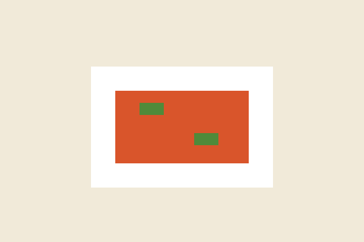

このブログの記事は、Markdown（GitHub と同じ書き方）で書いています。
自分用のメモもかねて、使える書き方と、実際にどう表示されるかをまとめておきます。

## 見出し

行のはじめに `##` を付けます。`#` が多いほど小さい見出しになります。

### 小見出し（###）

#### さらに小さい見出し（####）

見出しをつけておくと、もくじが自動でできます。

## 文字の飾り

`**太字**` `*斜体*` `~~取り消し~~` `` `コード` `` `[文字](URL)` と書きます。

**太字**、_斜体_、~~取り消し線~~、`コード`、[リンク](#文字の飾り) が使えます。
URL をそのまま書くと自動でリンクになります → https://simochee.net/
キーボードの操作は <kbd>Ctrl</kbd> + <kbd>C</kbd> のように書けます。

## リスト

`- 項目` `1. 項目` `- [x] 済んだこと` と書きます。字下げで入れ子になります。

- 喫茶店
- 本
  - ミステリー
  - エッセイ
- 散歩

1. お湯を沸かす
2. 豆を中細挽きにする
3. 30秒蒸らして、ゆっくり注ぐ

- [x] テンプレートを変える
- [x] SNSからフォローできるようにする
- [ ] 過去記事のカテゴリを整理する

## 引用

行のはじめに `>` を付けます。

> 次はナポリタンも食べていってね。
>
> ― 駅前の喫茶店のマスター

## コード

` ```js ` と ` ``` ` ではさみます。言語名を書くと色がつきます。

```js
// キリ番（ゾロ目・連番・きりのいい数）か調べる
function isKiriban(n) {
  const s = String(n);
  if (/^(\d)\1+$/.test(s)) return true; // 11111
  if ("0123456789".includes(s)) return true; // 12345
  return n % 10000 === 0; // 20000
}
```

```sh
npx wrangler deploy
```

行の強調や差分も書けます。

```ts
const before = "古い値"; // [!code --]
const after = "新しい値"; // [!code ++]
console.log(after); // [!code highlight]
```

## 表

`| 店名 | 回数 |` のように `|` で区切ります。`:--` `:-:` `--:` で左・中央・右寄せです。

| お店（左寄せ）      | 行った回数（中央） | 駅から（右寄せ） |
| :------------------ | :----------------: | ---------------: |
| 駅前の喫茶店        |        12回        |          徒歩3分 |
| 古本屋の2階のカフェ |        7回         |          徒歩8分 |
| 川沿いの珈琲店      |        4回         |         徒歩15分 |

## 注意書き

`> [!NOTE]` の次の行から本文を書きます。本文の1行目が色つきの見出しになります。NOTE・TIP・IMPORTANT・WARNING・CAUTION の5種類です。

> [!NOTE]
> 拍手はログインなしで押せます
> 記事の下の「拍手する」から。何回押しても大丈夫です。

> [!TIP]
> モーニングは11時まで
> 土日は少し混むので、平日の朝がおすすめです。

> [!IMPORTANT]
> コメントは確認してから表示します
> いたずら対策のため、表示まで少し時間がかかります。

> [!WARNING]
> 写真の無断転載はご遠慮ください
> 使いたいときは、ひとこと声をかけてください。

> [!CAUTION]
> 削除キーを忘れずに
> 忘れると、書きこみを自分で消せなくなります。

## 画像と折りたたみ

`` と書きます。折りたたみは `<details>` を使います。



<details>
<summary>ナポリタンの感想（クリックで開く）</summary>

ケチャップ多めで、ピーマンがしゃきしゃき。粉チーズはかけ放題でした。次は大盛りにします。

</details>

## 脚注と区切り線

本文に `[^1]`、記事の最後に `[^1]: 説明` と書きます。区切り線は `---` です。

このテンプレートは、2008年ごろのブログを思い出しながら作りました[^1]。文字はドットのフォント[^2]です。

---

[^1]: ツーカラムで、サイドバーにカレンダーとカウンターがあるあの感じです。

[^2]: 東雲フォント（パブリックドメイン）を使っています。
